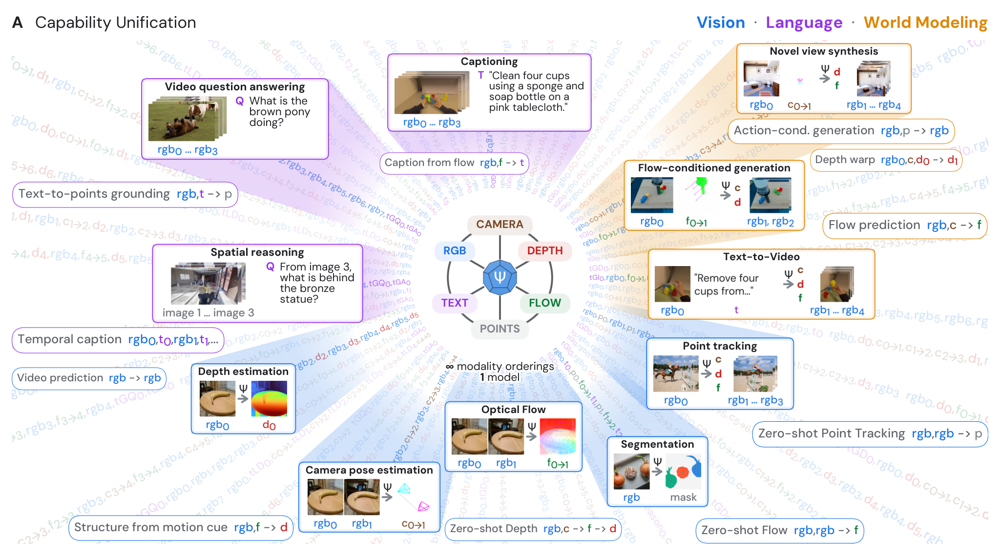
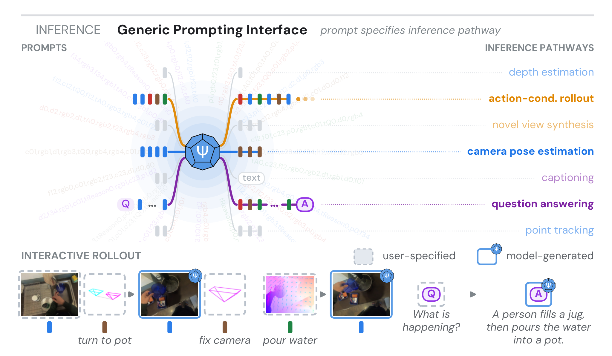
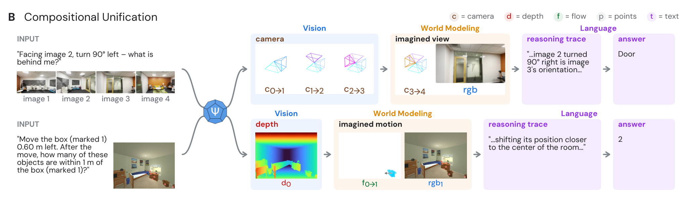
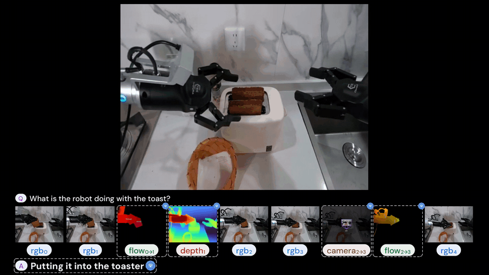
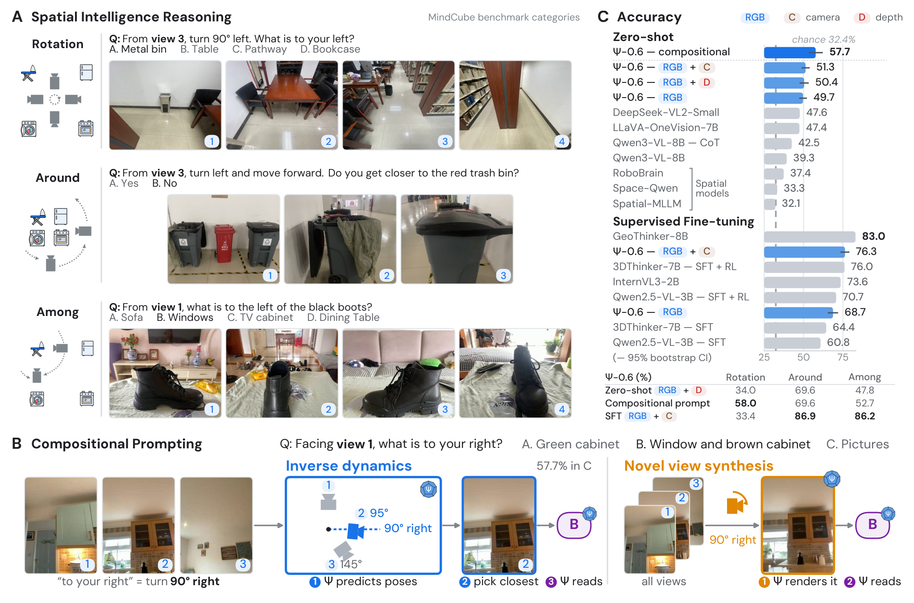
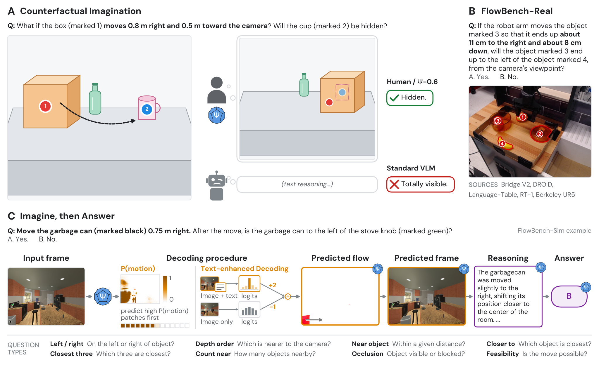

<p align="center">
  
</p>

<h1 align="center">Ψ-0.6: Adaptive Streams of Thought<br>in a Unified Vision-Language World Model</h1>

<p align="center">
  Khai Loong Aw<sup>*</sup>, Klemen Kotar<sup>*</sup>, Baihan Zhang<sup>*</sup>, Yifan Liu<sup>*</sup>,<br>
  Lilian Chen, Atlas Kazemian, Rahul Venkatesh, Daniel Yamins<br>
  <a href="https://neuroailab.stanford.edu">Stanford NeuroAI Lab</a>, Stanford University
  &nbsp;·&nbsp; <sup>*</sup>Equal contribution
</p>

<p align="center">
  <a href="https://arxiv.org/abs/2610.32177"></a>
  <a href="https://neuroailab.github.io/psi-website/blog/psi-0-6.html"></a>
  <a href="https://huggingface.co/StanfordNeuroAILab"></a>
  <a href="https://neuroailab.stanford.edu"></a>
  <!-- after the launch post: <a href="https://x.com/khai_loong_aw/status/[id]"></a> -->
</p>

<p align="center">
  <b>Chain-of-thought reasons in words. Ψ-0.6 reasons in words, depth, motion, camera pose, and imagined scenes,
  and learns which to use for each problem.</b>
</p>

## 📰 News

- **[2026-10]** 📄 Paper released on [arXiv](https://arxiv.org/abs/2610.32177).
- **[2026-11]** 🤗 Model weights and inference code: coming soon. Watch this repo for the release.

## 💡 Overview

Humans reason about the physical world by flexibly combining different forms of inference as a problem unfolds.
In AI, these capabilities usually live in separate specialized models, which limits how they can be composed.
**Ψ-0.6** is one *vision-language world model* that generates and interprets images, text, and explicit
representations of geometry and motion, and chains them into **streams of thought**.

### (1) One model

<p align="center"></p>

Ψ-0.6 combines a vision-language model and a world model: images, text, camera pose, depth, flow, and point tracks
share one vocabulary and one 8B transformer. Every task is a token ordering: perceiving, describing, and simulating
become different questions to the same weights.

### (2) One interface

<p align="center"></p>

Any output can be the next input. A camera pose is an estimate when inferred from two images, a command when used to
render a view, and a thought when used to answer a question. Chained, these steps become streams of thought: estimate
the camera motion → imagine the new view → answer, or predict depth → imagine the object moving → answer.

<p align="center"></p>

### (3) RL learns adaptive streams of thought

<p align="center"></p>

One model produces every step, so a stream of thought can be optimized end to end from task feedback, not stitched
together from separately trained parts. Ψ-0.6 learns which representation to reason through for each question, and
its answers improve, even on unseen benchmarks.

## 📊 Results

### Multi-view spatial reasoning (MindCube)

<p align="center"></p>

Zero-shot, Ψ-0.6 surpasses leading open-weight VLMs and spatial specialists on MindCube (**51.3%** vs 47.6% for the
best open-weight baseline). Reasoning through camera pose (predict each view's pose, pick the view that answers the
question, and read it) raises accuracy to **57.7%**.

### Counterfactual imagination (FlowBench)

<p align="center"></p>

Asked what happens if an object moves, Ψ-0.6 predicts the motion as optical flow, renders the imagined scene, and
answers from it. Its flow predictions reach **56.4%** accuracy, versus 16.4% for the strongest image-editing baseline
and 50.8% for a modular expert pipeline (Grounding DINO + SAM 2 + Depth Pro) that is given the camera intrinsics.

## 🗓️ Release plan

- [x] Paper
- [ ] Model weights on 🤗 Hugging Face
- [ ] Inference code and prompting examples
- [ ] Evaluation code

## 📖 Citation

```bibtex
@article{aw2026psi06,
  title   = {$\Psi$-0.6: Adaptive Streams of Thought in a Unified Vision-Language World Model},
  author  = {Aw, Khai Loong and Kotar, Klemen and Zhang, Baihan and Liu, Yifan and
             Chen, Lilian and Kazemian, Atlas and Venkatesh, Rahul and Yamins, Daniel},
  journal = {arXiv preprint arXiv:2610.32177},
  year    = {2026}
}
```

## 🙏 Acknowledgments

Thanks to the [Stanford AI Lab](https://ai.stanford.edu), the [Stanford Vision and Learning Lab](https://svl.stanford.edu),
[Stanford Marlowe](https://datascience.stanford.edu/marlowe) ([Stanford HAI](https://hai.stanford.edu) and
[Stanford Data Science](https://datascience.stanford.edu)), and Google's
[TPU Research Cloud](https://sites.research.google/trc/) for help and computing support.
